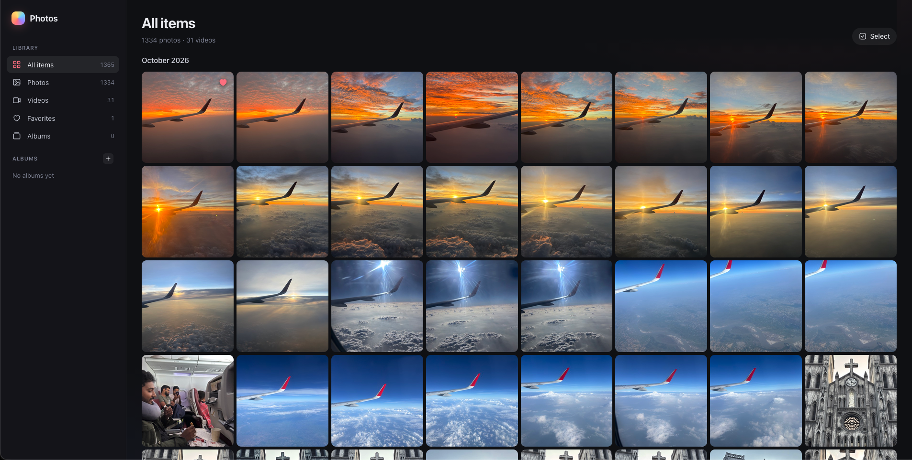

# Photos

A tiny, self-hosted photo & video browser. Drop files into `./data`, open the browser, and
organize them with favorites and albums.



## Features

- Browse everything in `./data`: **All items**, **Photos**, **Videos**, **Favorites**, grouped by day
- **Favorites**: heart any item, from the grid or the full-screen viewer
- **Albums**: they exist only in the database, so your files are never moved. One item can be in many albums.
- **Multi-select**: click the check circle, ⌘/Ctrl-click, Shift-click for a range, ⌘A,
  the circle next to a day to grab the whole day, or **long-press and drag** across photos
  (works with a mouse or a finger; drag to the screen edge to auto-scroll).
  Then favorite, add to an existing or new album, or remove from the current album.
- **Lightbox**: arrow keys to navigate, `F` to favorite, `A` to add to album, `Esc` to close
- Fast with large libraries: cached thumbnails, video previews on hover, and a grid that
  renders in chunks as you scroll
- New files show up when you reload the page, with no restart needed

## Run with Docker (recommended)

```bash
docker compose up -d --build
```

Open <http://localhost:3030>.

The project folder is mounted into the container, so everything stays on your machine:

| Path          | What                                         |
| ------------- | -------------------------------------------- |
| `./data/`     | your photos and videos (just paste files in) |
| `./photos.db` | SQLite database (favorites, albums)          |
| `./.thumbs/`  | generated thumbnails (safe to delete)        |

Restarting or rebuilding the container keeps your database. Stop it with `docker compose down`.

## Run locally (without Docker)

Requires **Node 22.13+** (for the built-in `node:sqlite`), **pnpm**, and **ffmpeg** for video
thumbnails. Image thumbnails use macOS `sips`, or `vipsthumbnail` on Linux.

```bash
pnpm install
pnpm dev     # dev mode with hot reload  → http://localhost:3030
pnpm start   # build + serve             → http://localhost:3030
```

Use `PORT=4000 pnpm start` to change the port. Don't run the local server and the Docker
container at the same time, because they share the same database file.

## How it works

- `server.js` is a plain Node `http` server with no framework. It scans `./data` on each request,
  keeps metadata in SQLite, serves media with range requests (for video seeking), and generates
  thumbnails on demand.
- `index.html` and `src/` are a vanilla JS + CSS frontend, built with Vite.

## Supported formats

Images: jpg, jpeg, png, gif, webp, avif, bmp, svg, heic (HEIC only displays in Safari).
Videos: mp4, webm, mov, m4v, ogg, mkv.

---

Vibecoded to organize my photos after a trip. Not for production use.
